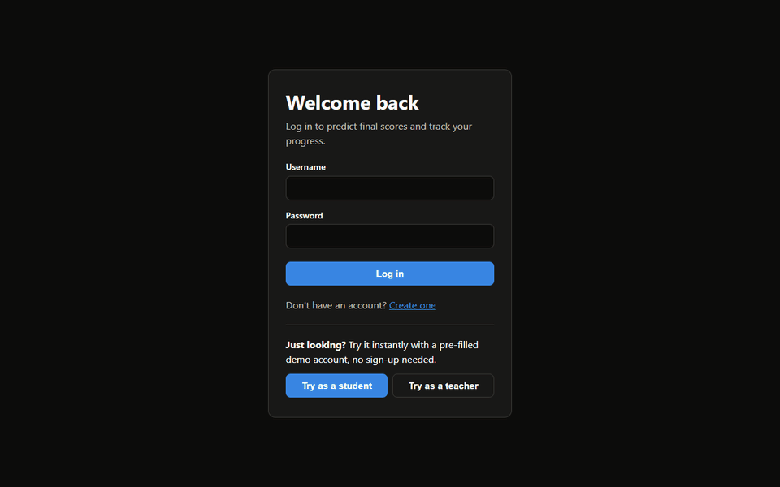
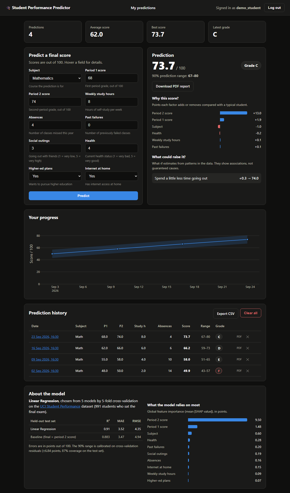
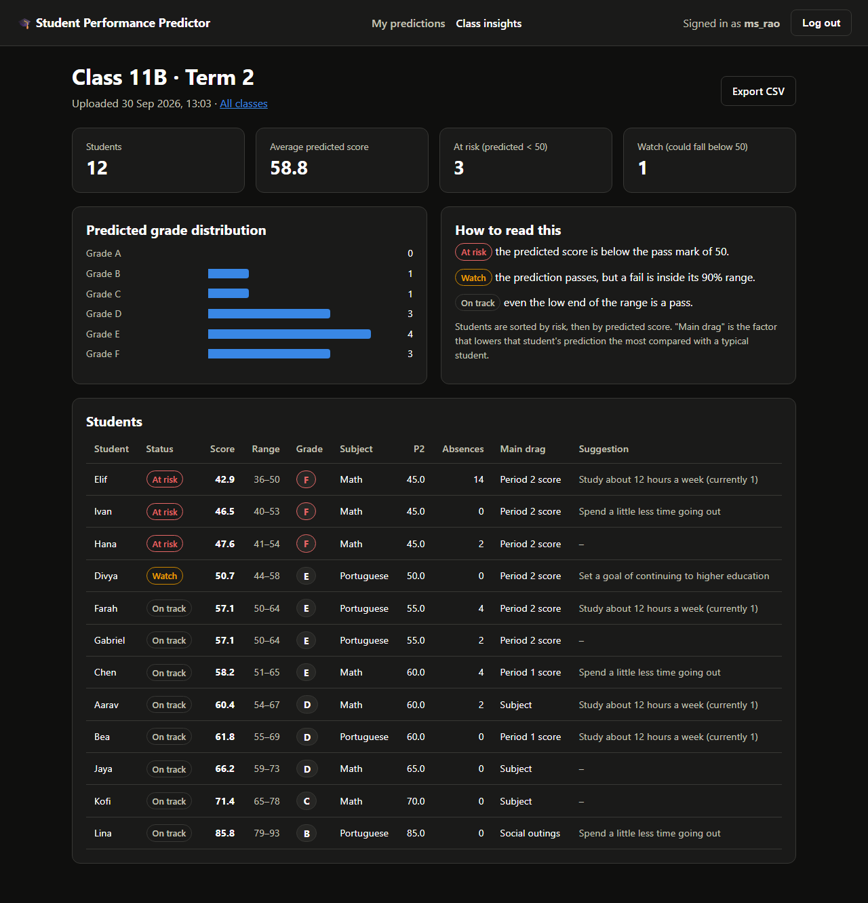
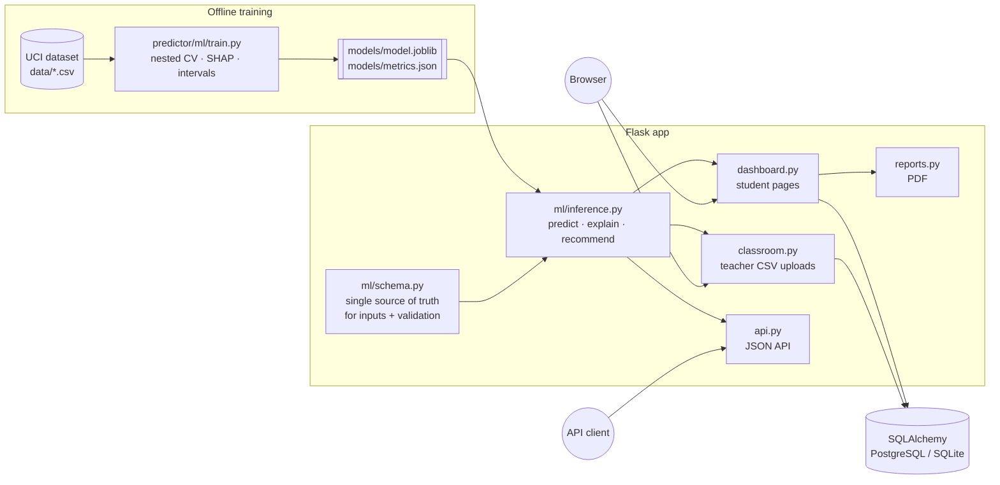

# 🎓 Student Performance Predictor

[](https://github.com/AnushreeKasturi/student-performance-predictor/actions/workflows/ci.yml)


A full-stack machine learning web app that predicts a student's **final exam score** from their earlier grades, study habits and background. It explains *why* it predicted that score and suggests what could raise it.

Built on **1,044 real student records** from the [UCI Student Performance dataset](https://archive.ics.uci.edu/dataset/320/student+performance). The model was selected from 5 candidates with nested cross-validation, benchmarked against a naive baseline, and every prediction comes with a calibrated 90% range.

🌐 **Live demo:** https://student-performance-predictor-1mlt.onrender.com: click **Try as a student** or **Try as a teacher**, no sign-up needed.
<sub>Hosted on Render's free tier, so the first load can take ~50 seconds while the server wakes up.</sub>



---

## ✨ Features

**For students**
- 📊 **Score prediction with a 90% range**: not just a number, but an honest range calibrated on held-out data
- 🔍 **"Why this score?"**: per-prediction explanations showing how each factor moved the prediction versus a typical student
- 💡 **What-if recommendations**: which realistic habit changes (study time, absences, …) would raise the prediction, and by how much
- 📈 **Progress tracking**: prediction history, trend chart, CSV export and a downloadable **PDF report**

**For teachers**
- 🏫 **Class insights**: upload a CSV of a whole class and get every student's predicted score, ranked by risk (*At risk / Watch / On track*), with the main factor holding each student back
- 📥 CSV template, validation with row-level error messages, and exportable results

**For visitors**
- 🚀 **One-click demo**: each visitor gets a private, pre-filled demo account (student or teacher) that's deleted after 24 hours

**For developers**
- 🔌 **REST API**: `POST /api/predict`, `POST /api/predict/batch`, `GET /api/schema`, `GET /api/health`
- ✅ **63 automated tests** (pytest) and **GitHub Actions CI** with linting (ruff)
- 🐳 **Docker** support, **PostgreSQL** in production and SQLite locally
- 🔐 Hashed passwords, CSRF protection, secrets from environment variables, role-based access control

| Student dashboard | Class insights (teacher view) |
|---|---|
|  |  |

📄 [Sample PDF report](screenshots/sample_report.pdf)

---

## 🧠 The machine learning

### Data
[UCI Student Performance](https://archive.ics.uci.edu/dataset/320/student+performance) (Cortez & Silva, 2008) covers students from two Portuguese secondary schools, across Maths and Portuguese courses. The app uses 10 inputs a student can actually provide: earlier-period grades, weekly study time, absences, past failures, social outings, health, higher-education plans, internet access and subject.

### A data-quality finding that changed the model
53 students have a final grade of exactly **0**. They didn't sit the final exam, and **every one of them has 0 recorded absences**, which is a recording artifact, not perfect attendance. Left in, these rows teach the model that *fewer absences → lower scores* (correlation −0.22 flips sign). The app therefore predicts the score of students who sit the exam, and excludes these rows. Details are in the [notebook](notebooks/eda_and_modelling.ipynb).

### Model selection
Five models were compared with 5-fold cross-validation, with hyperparameters tuned by an inner grid search (nested CV):

| Model | CV R² | CV MAE | CV RMSE |
|---|---|---|---|
| **Linear Regression** ✅ | **0.904** | 3.31 | **4.52** |
| Ridge Regression | 0.904 | 3.31 | 4.52 |
| Gradient Boosting | 0.902 | 3.28 | 4.56 |
| Random Forest | 0.896 | 3.40 | 4.69 |
| Gradient Boosting with monotonic constraints | 0.896 | 3.35 | 4.69 |

The simplest model won, and it's also the easiest to explain. On the **held-out test set**:

| | R² | MAE | RMSE |
|---|---|---|---|
| **Linear Regression** | **0.910** | 3.52 | **4.35** |
| Naive baseline (*final = period-2 score*) | 0.883 | 3.47 | 4.94 |

The model cuts RMSE by **12%** versus the baseline. MAE is about the same, so the gain comes from avoiding *large* misses. Scores are out of 100.

### Explainability and uncertainty
- **Global:** SHAP values show that earlier grades dominate, followed by subject, health, past failures and social life.
- **Per prediction:** each factor's impact is measured by swapping it for values from typical students and measuring the change.
- **Prediction range:** the 90th percentile of out-of-fold residuals (split-conformal style): ±6.8 points, with 87% coverage on the test set.
- Recommendations are *associations* learned from observational data, not causal effects, and the app says so.

---

## 🏗️ Architecture



```
student-performance-predictor/
├── app.py                    # WSGI entrypoint (gunicorn app:app)
├── predictor/
│   ├── __init__.py           # app factory
│   ├── config.py             # env-based config (SECRET_KEY, DATABASE_URL)
│   ├── models.py             # User, Prediction, ClassReport
│   ├── auth.py               # signup / login / logout (Flask-Login, Flask-WTF)
│   ├── dashboard.py          # predictions, history, CSV + PDF export
│   ├── classroom.py          # teacher class uploads
│   ├── demo.py               # one-click demo accounts
│   ├── api.py                # REST API
│   ├── charts.py, reports.py # Plotly trend chart, PDF report
│   ├── ml/
│   │   ├── schema.py         # input features + validation
│   │   ├── dataset.py        # load + clean UCI data
│   │   ├── train.py          # model comparison + export
│   │   ├── inference.py      # prediction, explanation, recommendations
│   │   └── batch.py          # whole-class predictions
│   ├── templates/  static/
├── models/                   # trained model + metrics
├── data/                     # UCI dataset + demo_class.csv (example teacher upload)
├── notebooks/                # EDA & modelling walkthrough
├── tests/                    # pytest suite
├── Dockerfile  .github/workflows/ci.yml
```

---

## 🔌 API

```bash
curl -X POST https://student-performance-predictor-1mlt.onrender.com/api/predict \
  -H "Content-Type: application/json" \
  -d '{"subject": "math", "period1_score": 60, "period2_score": 65, "study_hours": 4,
       "absences": 6, "failures": 0, "goout": 3, "health": 4, "higher": "yes", "internet": "yes"}'
```

```json
{
  "model": "Linear Regression",
  "predicted_score": 64.9,
  "grade": "D",
  "interval": {"lower": 58.1, "upper": 71.8, "coverage": 0.9},
  "impacts": [{"feature": "period2_score", "label": "Period 2 score", "value": 5.72}, "..."],
  "recommendations": [{"feature": "goout", "message": "Spend a little less time going out", "gain": 0.3, "new_score": 65.2}]
}
```

| Endpoint | Description |
|---|---|
| `GET /api/health` | Service status and model name |
| `GET /api/schema` | Input features, ranges and allowed values |
| `POST /api/predict` | One student → score, range, grade, explanation, recommendations |
| `POST /api/predict/batch` | `{"students": [...]}` (up to 500) → results ranked by risk |

Invalid input returns `400` with per-field error messages.

---

## ⚙️ Running locally

```bash
git clone https://github.com/AnushreeKasturi/student-performance-predictor.git
cd student-performance-predictor
python -m venv .venv && source .venv/bin/activate   # Windows: .venv\Scripts\activate
pip install -r requirements-dev.txt
cp .env.example .env                                  # then set SECRET_KEY
python app.py                                         # http://localhost:5000
```

| Task | Command |
|---|---|
| Run tests | `pytest` |
| Lint | `ruff check .` |
| Retrain the model | `python -m predictor.ml.train` |
| Run with Docker | `docker build -t spp . && docker run -p 8000:8000 -e SECRET_KEY=... spp` |

### Deploying (Render)
- **Build:** `pip install -r requirements.txt` · **Start:** `gunicorn app:app`
- **Environment variables:** `SECRET_KEY` (a long random string), `SESSION_COOKIE_SECURE=1`, and `DATABASE_URL` from a Render PostgreSQL instance. Without `DATABASE_URL` the app uses SQLite, which Render wipes on every deploy.

---

## 💡 What I learned
- **Question the data before the model.** The most impactful change was spotting that the dropout rows were distorting the absences effect, not trying a fancier algorithm.
- **Always compare against a baseline.** "R² = 0.91" sounds great until you see a one-line rule gets 0.88. Reporting both keeps the results honest.
- **Simple can win.** Linear regression matched or beat tree ensembles, and it's far easier to explain to a student or teacher.
- **Uncertainty matters for decisions.** The teacher view's *Watch* flag exists because a prediction of 55 with a range of 48–62 is not "safe".

## 🚀 Future work
- Dropout-risk classifier for students likely not to sit the exam
- An early-warning model that works before any grades exist (R² is only ~0.2 without them)
- Database migrations with Alembic, and a light theme

## 📚 Dataset citation
P. Cortez and A. Silva. *Using Data Mining to Predict Secondary School Student Performance.* In A. Brito and J. Teixeira (Eds.), Proceedings of 5th FUture BUsiness TEChnology Conference (FUBUTEC 2008), pp. 5–12, Porto, Portugal, April 2008. Licensed CC BY 4.0.

## 👩‍💻 Author
**Anushree Kasturi** · [GitHub](https://github.com/AnushreeKasturi)
